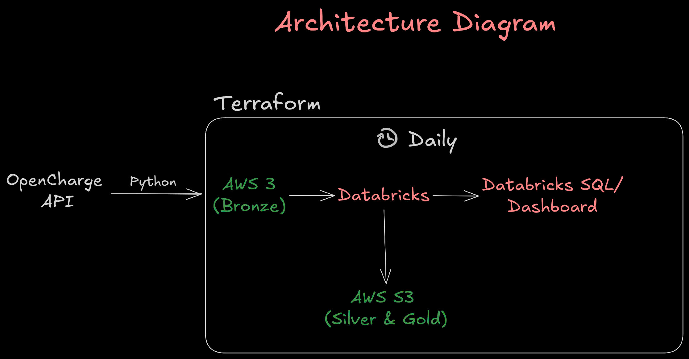

# EV Charging Analytics Pipeline

Analyze EV charging coverage by region and compare connector types and station operators. The pipeline ingests Open Charge Map station and reference data into AWS S3 and uses Databricks, PySpark, and Delta Lake to publish tables for SQL reporting and dashboards.

## Architecture



Terraform provisions AWS and Databricks resources and manages the SQL analytics layer. Python ingests `/v3/poi` station records and `/v3/referencedata/` lookups. Databricks jobs process each ingestion date through the three layers of the medallion architecture.

## Data Layers

### Bronze

- Raw Open Charge Map snapshots in S3
- Partitioned by ingestion date

### Silver

- `stations` and `connections` Delta tables
- Optional enrichment from reference snapshots

### Gold

- Aggregate Delta tables for reporting:
  - `kpi_summary`
  - `stations_by_region`
  - `connectors_by_type`
  - `stations_by_operator` (reference-enabled)
  - `stations_by_usage_type` (reference-enabled)
  - `operator_connector_summary` (reference-enabled)

## Requirements

- Python 3.9+
- Terraform 1.6+
- AWS account with S3 and IAM permissions
- Databricks workspace on AWS
- Open Charge Map API key

## Setup and Run (Linux)

### 1. Create Python environment

```bash
python3 -m venv .venv
source .venv/bin/activate
python -m pip install --upgrade pip
pip install -r requirements.txt
```

### 2. Configure environment variables

```bash
cp .env.example .env
# edit .env with your values
set -a
source .env
set +a
```

Required keys:

- `OCM_API_KEY`
- `AWS_ACCESS_KEY_ID`
- `AWS_SECRET_ACCESS_KEY`
- `AWS_REGION`
- `EV_PIPELINE_S3_BUCKET`
- `DATABRICKS_HOST`
- `DATABRICKS_TOKEN`

### 3. Provision AWS layer

```bash
cd terraform/aws
cp terraform.tfvars.example terraform.tfvars
# edit terraform.tfvars
terraform init
terraform apply
cd ../..
```

### 4. Fetch and upload raw data

```bash
python scripts/fetch_openchargemap.py --country-code FI --max-results 300
python scripts/fetch_openchargemap.py --reference-only
python scripts/upload_sample_data.py --date DATE --all
```

### 5. Provision Databricks layer

```bash
cd terraform/databricks
cp terraform.tfvars.example terraform.tfvars
# edit terraform.tfvars (instance profile ARN, bucket name, partition date)
terraform init
terraform apply
cd ../..
```

### 6. Execute pipeline

- Run Databricks job `ev-charging-openchargemap-pipeline`
- Or run notebooks manually starting from `01_ingest_orchestrator.py`
- Open `05_analytics_dashboard.py` for exploration

## Configuration

- Use `.env.example` as the template for runtime secrets
- Use `terraform.tfvars.example` in each Terraform folder as the template for IaC variables
- Keep `.env`, `terraform.tfvars`, and Terraform state files out of source control

## Troubleshooting

- Missing AWS credentials
  - Reload `.env` in your shell: `set -a; source .env; set +a`
- Databricks cluster cannot read S3
  - Verify instance profile ARN and IAM permissions
- Missing reference-based Gold tables
  - Ensure reference snapshots were fetched and uploaded
- Terraform authentication issues
  - Verify AWS credentials and Databricks token are active

## Security Checklist

- Do not commit `.env`, `terraform.tfvars`, or Terraform state files
- Rotate keys immediately if credentials were exposed
- Keep sample/template config files only in Git
